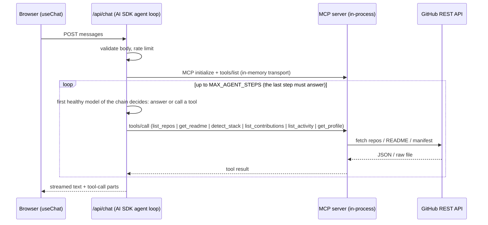

# Portfolio Agent

A small, complete example of a **GenAI-powered fullstack app**: a chat UI, an **LLM agent** with a tool loop, and a **Model Context Protocol (MCP) server** that exposes a GitHub portfolio as tools. The agent answers questions like *"which projects use Supabase?"*, *"which open source projects has this person contributed to?"*, *"what have they been working on lately?"* or *"what work experience do they have?"* by calling those tools on live GitHub data and on the owner's CV and portfolio site.

| Tool | Answers |
|---|---|
| `list_repos` | Which projects exist: description, language, stars, topics |
| `get_readme` | What a project does and how it is built |
| `detect_stack` | Runtime, frameworks and libraries, following monorepo workspaces |
| `list_contributions` | Pull requests opened in other people's and organizations' repositories, merged or not, approved or not, optionally narrowed to one project. Private work appears only as GitHub's own count (e.g. "741 contributions to private repositories in the last year"), which never says which repositories: the agent states that count and never names or guesses them |
| `list_activity` | Recent work in the owner's own repositories: the newest commits (merge commits left out) and the pull requests opened there, with how many were merged. Public repositories only |
| `get_profile` | What the owner's CV and portfolio site say: experience, education, skills, projects (including ones not on GitHub) and links. Several sections in one call, attributed to their source |

Everything runs on free tiers (Groq, Google AI Studio, public GitHub API, Vercel). The LLM is an ordered **fallback chain** set by one environment variable: when a free-tier model is overloaded, rate limited or slow, the same step moves to the next model instead of failing in front of the visitor. Claude Haiku can join as the one paid link, last in the chain, so it answers only when every free model has failed.

## Architecture



Three layers, each swappable on its own:

| Layer | Where | Role |
|---|---|---|
| **MCP server** | `packages/mcp-server` | Framework-agnostic package. Hexagonal: tools depend on a `GitHubPort`; the REST adapter is one implementation. Runs in-process, over HTTP (`/api/mcp`) or over stdio (any MCP host). |
| **Agent** | `apps/web/src/app/api/chat` | Vercel AI SDK `streamText` with `stopWhen: isStepCount(...)`. The model is a fallback chain (`lib/llm/fallback.ts`). Tools come from `createMCPClient(...).tools()`: a real MCP client, connected to the real server over an in-memory transport by default. |
| **UI** | `apps/web/src/components/chat` | `useChat` container plus presentational parts. Every tool call is rendered with its status and payloads, and every answer shows the model that served it and how long it took. |

**Why in-process by default?** The agent and the MCP server ship together, so the agent does not need a network hop, a self-request on serverless, or any URL derived from the incoming request. Set `MCP_SERVER_URL` to point the agent at any remote MCP server instead; the wiring stays the same because it is MCP on both sides.

The provider registry (`apps/web/src/lib/llm/provider.ts`) is one table: `PROVIDER_REGISTRY` maps a name to its default model, API key variable and `@ai-sdk/*` factory. Adding a provider is adding one entry (plus installing its package).

Design decisions and their trade-offs are written up in [`docs/architecture.md`](docs/architecture.md).

## Reliability on free tiers

Measured on 2026-10-21 before these safeguards: the default Gemini model answered 503 "high demand" to three questions out of three, or took 18-40 s per call, and Groq returned 429 after two questions. Now each failure has an answer:

| What goes wrong | What happens | Where |
|---|---|---|
| A model returns 503 or 429 | The same step is replayed on the next model of the chain, immediately | `lib/llm/fallback.ts` |
| Every free model of the chain is out of quota or down | Claude Haiku, last in the chain, answers; a Console workspace spend limit caps what it can cost | `PROVIDER_REGISTRY` in `lib/llm/provider.ts` |
| A model accepts the request but produces nothing for 8 s | The attempt is cancelled and the next model gets the step | `DEFAULT_FIRST_CHUNK_TIMEOUT_MS` |
| A model keeps calling tools until the step budget runs out | The last step may not call tools, so every question ends with an answer | `stepSettings` in `lib/agent/instructions.ts` |
| Long conversations eat the per-minute token budget | Earlier tool payloads and reasoning are pruned from the replayed history; tool results are compact JSON; READMEs are capped at 4,000 characters | `api/chat/route.ts`, `packages/mcp-server` |
| GitHub's 60 requests/hour (unauthenticated) | GitHub reads are cached for 10 minutes and shared across requests | `CachingGitHubPort`, `lib/mcp/github.ts` |
| The visitor presses Stop | The abort reaches the model and the tools, and is never mistaken for a model failure | `abortSignal` |

## Quick start

Requirements: Node >= 22.12 and pnpm.

```bash
pnpm install
cp apps/web/.env.example apps/web/.env.local
# add GROQ_API_KEY (free at https://console.groq.com/keys)
# and GOOGLE_GENERATIVE_AI_API_KEY (free at https://aistudio.google.com/apikey)
# optional: ANTHROPIC_API_KEY (paid, https://platform.claude.com) for Claude Haiku as the last fallback
pnpm dev
```

Open http://localhost:3000 and ask about the projects.

### Choosing models: the fallback chain

`LLM_PROVIDER` is an ordered, comma-separated list of `provider` or `provider:model` entries. Each agent step goes to the first entry and falls back along the list:

```bash
# apps/web/.env.local
LLM_PROVIDER=groq,google,google:gemini-3.5-flash-lite   # recommended: fast first, then Gemini
LLM_PROVIDER=groq,google,anthropic                      # free first, Claude Haiku only when both fail
LLM_PROVIDER=google                                     # a single model, no fallback (the default)
LLM_MODEL=gemini-3.5-flash                              # optional: model of the first entry, when it names none
```

Every entry needs its provider's API key; a missing one is a configuration error, not a silent skip. Defaults live in `PROVIDER_REGISTRY` (`gemini-3.6-flash` for Google, `openai/gpt-oss-120b` for Groq, `claude-haiku-5-5` for Anthropic). Groq's free tier allows 8,000 tokens per minute *per model*, so listing two Groq models gives two separate budgets.

### Pointing it at another GitHub user

Set `GITHUB_OWNER` in `apps/web/.env.local`. The owner is server configuration: tools never accept it as input, so a caller cannot redirect the server (and any `GITHUB_TOKEN` it holds) to another account.

`get_profile` serves `packages/mcp-server/src/data/profile.json`, which belongs to the default owner. For any other owner it answers that no CV data is published, so one person's CV is never presented as someone else's. Replace that file to use your own.

### Updating the CV and portfolio data

The CVs (PDF) and the portfolio site were converted once into `packages/mcp-server/src/data/profile.json`, so a question costs one local tool call instead of a PDF parse or a page fetch. Text is copied from the sources in their own language, and `sources` records each one with its date. To update it, edit the JSON: the type check rejects a field with the wrong shape, and `test/profile.test.ts` fails if an email address or a phone number gets in (contact goes through the portfolio site, which already publishes it).

## Use the MCP server from Claude Code (or any MCP host)

Over HTTP, while `pnpm dev` is running:

```bash
claude mcp add --transport http portfolio-agent http://localhost:3000/api/mcp
# with MCP_AUTH_TOKEN set on the server:
claude mcp add --transport http portfolio-agent http://localhost:3000/api/mcp \
  --header "Authorization: Bearer <token>"
```

Over stdio, without the web app:

```bash
pnpm mcp:build
claude mcp add portfolio-agent -- node packages/mcp-server/dist/stdio.js
```

Then ask Claude Code: *"Use portfolio-agent to list the repos and detect the stack of the newest one."*

## Security notes (demo-grade, but deliberate)

- **The dev server binds to `127.0.0.1`, not `0.0.0.0`.** `next dev` defaults to every interface, which quietly turns the bullet above into a different statement: with `MCP_AUTH_TOKEN` unset, anyone on the same network could call `/api/mcp` and `/api/chat` unauthenticated and spend the free-tier quota. "Open outside production" was always meant as "open to you"; the `-H` flag in the `dev` script is what makes that true. Pass `-H 0.0.0.0` deliberately when you want to reach the app from a phone on the same Wi-Fi.
- `/api/mcp` is open outside production unless `MCP_AUTH_TOKEN` is set. **In production, an unset `MCP_AUTH_TOKEN` fails closed**: every request is refused with a 503 rather than silently staying open. Set the token before deploying with any credential worth protecting.
- Both public endpoints (`/api/mcp` and `/api/chat`) share one guard floor (`lib/http/guards.ts`): rate limit first, then auth. `/api/mcp` and `/api/chat` each get their own rate-limiter instance, so one endpoint's traffic never evicts the other's buckets.
- `/api/chat` validates the body with zod (message count, roles, and the parts and text length of user messages; earlier assistant answers come back as history and are bounded by the aggregate budget below, so a long answer never blocks the next question) and applies an in-memory per-IP rate limit (20 requests / 10 minutes). The limiter is per process, so on serverless it is best-effort; use a shared store for real traffic.
- The rate-limiter's bucket map is bounded (10,000 tracked keys by default): expired buckets are pruned first, and if still over the cap the oldest remaining bucket is evicted, so a flood of distinct client keys cannot grow the map without limit.
- Client identity for rate limiting trusts `x-forwarded-for`/`x-real-ip` only when `TRUST_PROXY_HEADERS=1` is set. Vercel rewrites those headers at its edge for direct traffic, which is why they are trustworthy there, but the same is not true off-platform. Leave it unset outside Vercel (or behind an untrusted proxy): every caller then shares one rate-limit bucket, which is safe (over-throttling) rather than trivially bypassable per request.
- Error responses are opaque in production (`{ error, code }`); details go to the server log. Outside production the `detail` field is included to help development.
- **The chat answers only about the owner.** The instructions tell the model to decline unrelated requests (essays, translations, general questions), and `MAX_OUTPUT_TOKENS` caps every model call at 4,096 tokens, so a visitor cannot turn the public chat into a free general-purpose assistant. A determined prompt can still get past an instruction; the hard limit on what Claude can cost is its Console workspace spend limit.
- Repository names and file paths are validated before any GitHub request is built.
- **Never set `MCP_AUTH_TOKEN` to the same value as `GITHUB_TOKEN`.** They protect different boundaries: `MCP_AUTH_TOKEN` gates who may call `/api/mcp`, `GITHUB_TOKEN` is the credential the server presents to GitHub. The MCP route never forwards an inbound bearer to the GitHub adapter, but the two secrets should still never collide.
- `/api/chat` also caps the aggregate size of the validated `messages` payload (`MAX_PAYLOAD_BYTES`, 128 KiB), on top of the message-count cap and the user-message part and text caps. A per-part ceiling would only bound one part while hundreds of them can still arrive; the aggregate budget bounds the whole request regardless of how the size is spread across parts.
- **Client-authored history is trusted for its text, by design.** The client sends the whole conversation back on every turn and there is no server-side session state or signed history. Before that history reaches the model, every tool call, tool result and reasoning part prior to the latest user message is pruned (`pruneMessages` in `src/app/api/chat/route.ts`), so a tool result fabricated by the client never reaches the model; a forged assistant *answer* still can. That is acceptable only because every MCP tool reachable from that context is read-only and pinned to the server-configured `GITHUB_OWNER` (`resolveOwner`): forged text can mislead the model, but it cannot widen access or redirect a call to another owner's data. If a tool ever becomes write-capable or accepts a caller-supplied target instead of a server-pinned one, this trust boundary must be revisited.

## Tests

```bash
pnpm test        # vitest in both packages
pnpm typecheck   # tsc in both packages
pnpm lint
```

The MCP server is tested through a real MCP client over an in-memory transport (`packages/mcp-server/test/server.test.ts`), the tools against a fake `GitHubPort`, the cache with an injected clock, and the REST adapter against an injected `fetch`. The web package tests the fallback chain against fake `LanguageModelV4` models (HTTP errors, error parts, first-chunk timeouts, Stop), the in-process MCP connection through `@ai-sdk/mcp`, request validation, rate limiting, auth, the provider registry and the chat components. No network access is needed to run the suite.

## Project structure

```
apps/web/                      Next.js app (App Router)
  src/app/api/chat/route.ts    agent loop (AI SDK + in-process MCP client)
  src/app/api/mcp/route.ts     MCP server over Streamable HTTP (optional bearer auth)
  src/lib/llm/provider.ts      LLM provider registry + LLM_PROVIDER chain parsing
  src/lib/llm/fallback.ts      fallback model: fails over along the chain
  src/lib/mcp/client.ts        MCP connection: in-process by default, remote via MCP_SERVER_URL
  src/lib/mcp/github.ts        process-wide cached GitHub port for the in-process server
  src/lib/mcp/auth.ts          bearer auth for /api/mcp, fails closed in production
  src/lib/chat/request.ts      zod validation of the chat body
  src/lib/chat/rate-limit.ts   fixed-window rate limiter
  src/lib/chat/metadata.ts     per-answer metadata: serving model and duration
  src/lib/http/env.ts          injected Env type, isProduction, trustsProxyHeaders
  src/lib/http/guards.ts       shared guard floor: rate limit, then auth, for both public routes
  src/lib/http/errors.ts       opaque client errors
  src/lib/agent/instructions.ts  system prompt, step budget, final-step rule
  src/components/chat/         chat UI (container + presentational)
packages/mcp-server/
  src/ports/github.ts          GitHubPort (hexagonal port)
  src/adapters/github-rest.ts  GitHub REST adapter
  src/adapters/caching-github.ts  caching decorator for any GitHubPort
  src/tools/                   list_repos, get_readme, detect_stack, list_contributions, list_activity, get_profile
  src/data/profile.json        the owner's CV and portfolio site, converted for get_profile
  src/profile.ts               Profile type and DEFAULT_PROFILE
  src/server.ts                McpServer factory + tool registration
  src/validation.ts            GitHub owner / repository name rules
  src/owner.ts                 resolveOwner(): the one place the owner comes from
  src/stdio.ts                 stdio entrypoint
```

## Free-tier notes

- **Groq** answers a tool step in about 0.5-1.5 s, but its free tier allows 8,000 tokens per minute per model; a question with a couple of tool results uses roughly half of that. Put it first for speed and let the chain absorb its 429s.
- **Gemini** free tier (Flash models) allows roughly 10 requests/minute. The newest Flash is often the most overloaded one: pick a model you have measured, not the latest. Do not enable billing on the Google Cloud project or the free tier disappears.
- **Claude Haiku** (optional, and the only paid model) is $0.10 / $0.50 per million input / output tokens for prompts up to 100K tokens ($0.50 / $2.50 above). Keep it last in the chain so the free quotas are spent first. Create its API key in a Console workspace of its own and give that workspace a monthly spend limit: once the limit is reached, Anthropic refuses the requests instead of charging more. Claude Max 5x and 20x plans include monthly API credits that pay for it, claimed by linking a Console organization to the plan.
- One question costs 2-4 LLM calls, capped at `MAX_AGENT_STEPS`.
- **GitHub** allows 60 unauthenticated requests/hour per IP, and a question over several repositories can spend 10-20 of them. A token with no scopes (`GITHUB_TOKEN`) raises it to 5,000/hour; set one before a demo.

## Stack

Next.js 16, React 19, Tailwind CSS 4, Vercel AI SDK 7 (`ai`, `@ai-sdk/react`, `@ai-sdk/mcp`, `@ai-sdk/google`, `@ai-sdk/groq`, `@ai-sdk/anthropic`), MCP TypeScript SDK 2 (`@modelcontextprotocol/server`), Zod 4, Vitest 5, pnpm workspaces.
